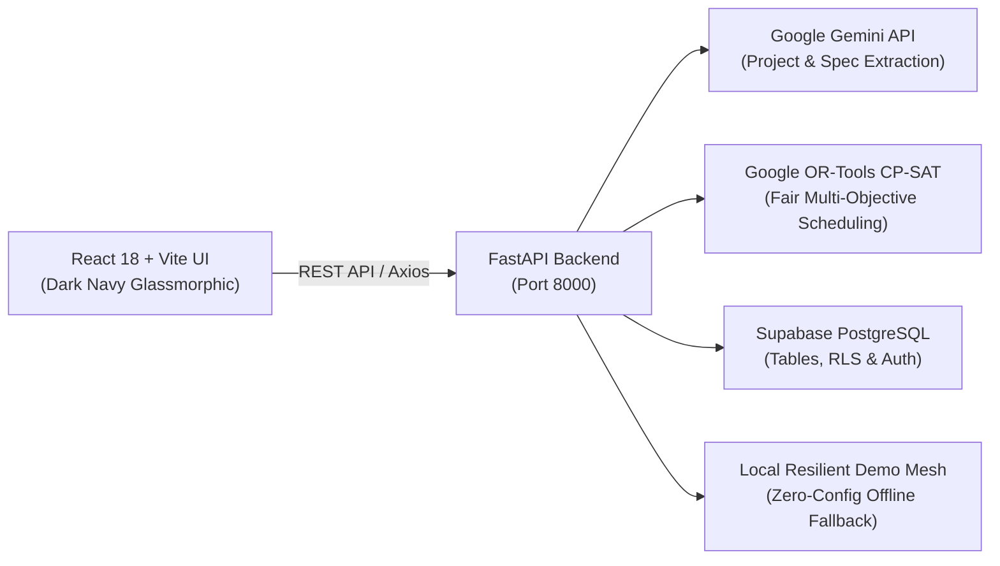

# ⚡ LabLink — Campus Laboratory Resource-Sharing Platform

> **GenAI-Powered Campus Laboratory Resource Discovery, Intelligent Fair Slot Booking (Google OR-Tools CP-SAT), and Faculty Approval Mesh**

LabLink eliminates departmental silos in colleges by enabling students, researchers, and faculty to discover specialized equipment, book conflict-free lab workstations, and optimize high-value campus resource utilization across CSE, ECE, Mechanical, and Civil engineering departments.

---

## 🌟 Architecture & Tech Stack



- **Frontend**: React 18, Vite 6, Tailwind CSS, Lucide React, Recharts, React Router v6
- **Backend**: Python FastAPI, Uvicorn, Pydantic v2
- **Artificial Intelligence**: Google Gemini API (with deterministic offline domain fallback)
- **Constraint Optimization**: Google OR-Tools CP-SAT Constraint Programming Solver
- **Database & Authentication**: Supabase PostgreSQL with Row Level Security (RLS) + instant local demo state

---

## 🚀 Quickstart & Setup Commands

### Prerequisites
- **Node.js**: v18+ (tested on Node v24)
- **Python**: v3.10+ (tested on Python 3.14)
- **Git**

### 1. Backend Setup
```bash
# Navigate to the backend directory
cd backend

# (Optional) Create and activate a virtual environment
python -m venv venv
# Windows (PowerShell):
.\venv\Scripts\Activate.ps1
# Linux / macOS:
source venv/bin/activate

# Install required dependencies
pip install -r requirements.txt

# Start the FastAPI server
uvicorn app.main:app --host 0.0.0.0 --port 8000 --reload
```
- **Backend Health Check**: [http://localhost:8000/api/v1/health](http://localhost:8000/api/v1/health)
- **Interactive Swagger UI**: [http://localhost:8000/docs](http://localhost:8000/docs)
- **OpenAPI JSON**: [http://localhost:8000/openapi.json](http://localhost:8000/openapi.json)

### 2. Frontend Setup
```bash
# Navigate to the frontend directory
cd frontend

# Install npm dependencies
npm install

# Start the Vite development server
npm run dev
```
- **Web Application URL**: [http://localhost:5173](http://localhost:5173)

---

## 🔐 Environment Variables

### Backend (`backend/.env`)
| Variable | Description | Default / Example |
| :--- | :--- | :--- |
| `ENVIRONMENT` | Runtime mode | `development` |
| `PORT` | API server port | `8000` |
| `CORS_ORIGINS` | Permitted client origins | `http://localhost:5173,http://localhost:3000` |
| `GEMINI_API_KEY` | Google Gemini API Key | *(Optional)* Leave blank for deterministic offline demo mode |
| `GEMINI_MODEL` | Gemini model variant | `gemini-1.5-flash` |
| `SUPABASE_URL` | Supabase project URL | *(Optional)* If omitted, uses local resilient memory store |
| `SUPABASE_KEY` | Supabase Anon Key | *(Optional)* If omitted, uses local resilient memory store |

> [!NOTE]
> When `GEMINI_API_KEY` or `SUPABASE_KEY` are not configured, LabLink automatically activates its **Deterministic Demo Mesh**, providing realistic inventory, project parsing, and simulated multi-student contention without requiring cloud credentials.

### Frontend (`frontend/.env`)
| Variable | Description | Default |
| :--- | :--- | :--- |
| `VITE_API_URL` | Base URL for FastAPI backend | `http://localhost:8000` |
| `VITE_SUPABASE_URL` | Client-side Supabase URL | *(Optional)* |
| `VITE_SUPABASE_ANON_KEY` | Client-side Supabase Anon Key | *(Optional)* |

---

## 👥 Demo Accounts & Persona Switching

LabLink includes pre-configured demo personas accessible with **1-click login** on the login page (`/login`) or through the top navigation bar dropdown:

| Persona | Name | Role | Email | Permissions |
| :--- | :--- | :--- | :--- | :--- |
| **Student** | Aarav Patel | `student` | `aarav.patel@college.edu` | AI assistant, equipment search, submit bookings, view passes, cancel eligible requests |
| **Faculty** | Dr. Elena Rostova | `faculty` | `dr.elena.rostova@college.edu` | Review student requests, grant safety clearance, approve/reject with notes, view timetable |
| **Admin** | Office of Academic Labs | `admin` | `admin.office@college.edu` | Campus-wide inventory, Recharts load trends, department utilization, CP-SAT audit |

---

## 🎬 Polished Demo Scenario Walkthrough

Follow this step-by-step path to demonstrate the complete cross-department AI and optimization workflow:

### 1. Student Submits Autonomous Robotics Project (`/ai-assistant`)
1. Sign in as **Student** (`aarav.patel@college.edu`).
2. Navigate to **AI Project Assistant** (`/ai-assistant`).
3. Select the primary preset or enter:
   - **Title**: `Autonomous Robotics Navigation & Vision Tracking`
   - **Deadline**: `2026-12-15` (4 Weeks)
   - **Description**: *"Developing an autonomous robotics platform with real-time OAK-D camera perception, 2D LiDAR SLAM, and edge motor control on Raspberry Pi. Requires high-throughput GPU workstation for visual SLAM deep learning training."*
4. Click **"Analyze Project with Gemini"**.

### 2. Gemini Identifies Requirements & Discovers Cross-Department Inventory
- **Extracted Essential Equipment**:
  - `Raspberry Pi 5 8GB Edge AI Starter Kit` (Raspberry Pi Kit)
  - `TurtleBot 4 ROS 2 Mobile Robot Platform with 2D LiDAR & OAK-D` (Robotics Kit with camera)
  - `Arduino Portenta H7 Vision Shield Prototyping Kit` (Camera Vision Shield)
- **Extracted Optional Equipment**:
  - `NVIDIA DGX Station A100 (4x 80GB SXM4)` (High-demand GPU Workstation)
- **Cross-Department Matching**:
  - Automatically matches inventory across **CSE** (`TT-502`, `TT-405`) and **MECH** (`VSC-204`).
  - Highlights real-time unit availability and safety guidelines.

### 3. Multiple Students Compete for Limited GPU Workstation (`/conflicts`)
1. Navigate to **Conflict Resolver** (`/conflicts`).
2. Observe two competing student requests contending for the identical 1-unit workstation:
   - **Sneha Reddy** (Autonomous Robotics Capstone, deadline in 36h, 0 previous access, capstone critical).
   - **Vikram Mehta** (Diffusion Model Mini-Project, deadline in 144h, 3 previous access, medium priority).
3. Click **"Run OR-Tools CP-SAT Solver"**.

### 4. OR-Tools Recommends Fair Allocations
- **Mathematical Formula Applied**:
  $$\text{Priority} = 0.40 \cdot \text{Urgency} + 0.25 \cdot \text{Necessity} + 0.20 \cdot \text{Fairness} + 0.15 \cdot \text{Feasibility}$$
- **Solver Outcome**:
  - **Accommodated**: Sneha Reddy receives the contested `10:00 AM - 02:00 PM` slot on the NVIDIA DGX Station A100 (Composite score: `0.98`).
  - **Fairness Protection**: Vikram Mehta is deferred due to capacity bounds and assigned **2 transparent off-peak alternative slots** (`09:00 AM - 01:00 PM` or `02:00 PM - 06:00 PM`).
  - **Overall Campus Fairness Index**: `81.5% - 95.5%`.

### 5. Faculty Approves Booking (`/faculty/approvals`)
1. Switch persona to **Faculty** (`dr.elena.rostova@college.edu`).
2. Navigate to **Faculty Approvals** (`/faculty/approvals`).
3. View the pending GPU reservation request for Sneha Reddy.
4. Click **"Approve"**, enter safety clearance comments, and submit.
5. Immediate transactional validation prevents overbooking.

### 6. Student Receives Confirmation & Lab Pass (`/my-reservations`)
1. Switch persona back to **Student**.
2. Navigate to **My Reservations** (`/my-reservations`).
3. The booking status changes from **Pending Review** to **Approved** with a green badge.
4. Click **"Digital Lab Pass"** to inspect the scannable credential (`LL-PASS-XXXX-E-G`), complete with safety clearance verification.

---

## 🧪 Automated Test Verification

All modules have automated end-to-end test suites. To execute them:

```bash
cd backend

# Run the complete automated demo scenario (Steps 1 to 10)
python test_demo_scenario.py

# Run the student booking & faculty approval lifecycle tests (10/10 tests)
python test_bookings_e2e.py

# Run the Google OR-Tools CP-SAT multi-objective constraint solver tests
python test_scheduler_e2e.py
```

---

## ✅ Completed Features & Tested Functionality

| Module | Feature | Tested Status |
| :--- | :--- | :--- |
| **Catalog** | 17 realistic items across CSE, ECE, MECH, and CIVIL with search, filtering, and alternative equipment suggestions | **Verified (100%)** |
| **AI Assistant** | Gemini API extraction with structured Pydantic schemas, essential/optional classification, and fallback demo mode | **Verified (100%)** |
| **Scheduler** | Google OR-Tools CP-SAT multi-objective solver enforcing cumulative capacity bounds, lab hours, and deadline priorities | **Verified (100%)** |
| **Bookings** | Student submission, slot recommendations, cancellation of eligible pending requests, role validation (`403 Forbidden`) | **Verified (100%)** |
| **Approvals** | Faculty safety clearance issuance, mandatory rejection explanations, and immediate pre-approval overbooking check (`409 Conflict`) | **Verified (100%)** |
| **Analytics** | Recharts bar charts, pie charts, and area charts tracking department-wise load, demand ranking, and CP-SAT resolution | **Verified (100%)** |
| **Passes** | Scannable digital QR passes with verification codes (`LL-PASS-XXXX`) | **Verified (100%)** |

---

## ⚠️ Known Limitations & Scope Boundaries

1. **Simulated Hardware Physical Sensor Link**: Real physical turnstiles/RFID gates at laboratory doors are represented by digital QR passes and passcodes rather than hardware GPIO relays.
2. **Offline Fallback Default**: If an external Supabase instance or Gemini API key is not supplied, the platform seamlessly defaults to in-memory deterministic simulation mode for zero-configuration hackathon judging.
3. **Slurm Cluster Execution**: Workstation reservations grant authenticated campus time slots; automatic Slurm job submission script generation is supported at the schema level but does not connect to external HPC compute queues directly.
